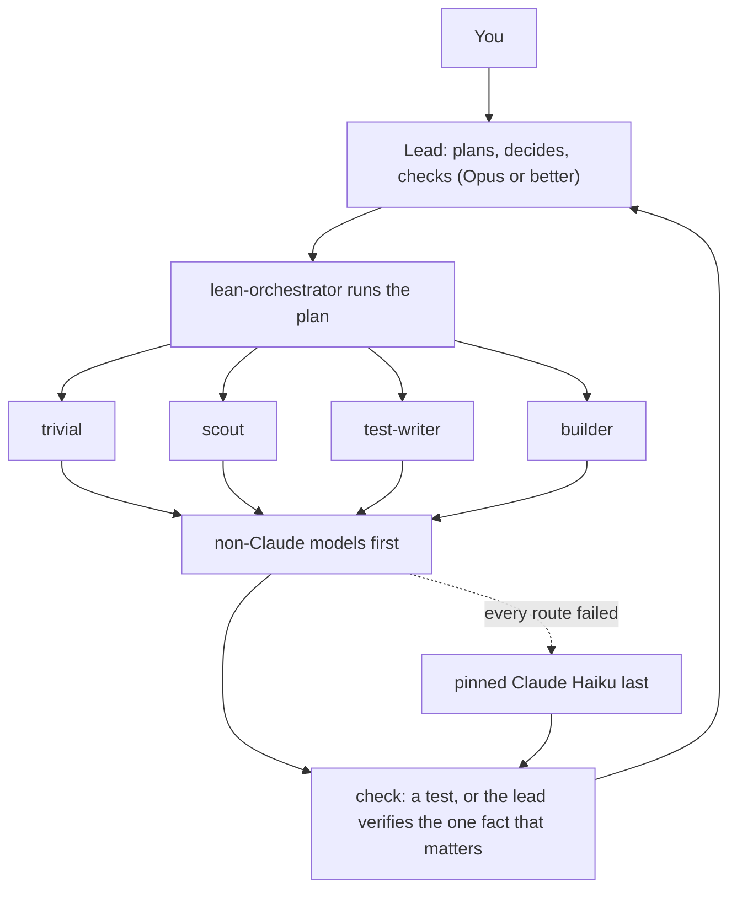

# claude-workforce

Let Opus think. Let free models do the legwork.

[](LICENSE) [](https://nodejs.org) [](https://github.com/ferasalm/claude-workforce/actions/workflows/test.yml)

claude-workforce is a set of skills (instruction files that Claude Code loads when needed) and agents for Claude Code. Your Pro or Max plan buys a limited amount of Claude usage. This project keeps that usage for decisions and hands the legwork, reading, searching and building, to free or cheap non-Claude models: Gemini Flash through Google's free Antigravity CLI, DeepSeek and GLM through NVIDIA's free API, OpenRouter free models, Cloudflare's free tier. A pinned Claude Haiku is the fallback, never the default.

## Why

- **Plan limits.** A Pro or Max plan gives you Claude usage per 5-hour window and per week. One broad session with helpers can spend a large part of it fast.
- **Unpinned helpers inherit your model.** When Claude Code spawns a subagent (a helper agent) without a `model:` line, that subagent runs on your session's model. Under Opus, every helper bills like Opus. Pinned means the model and effort are fixed in the agent's own file, so this cannot happen.
- **Most tokens are reading, not deciding.** Every tool call re-sends the conversation so far, so tokens pile up on reading files and searching. Judgement is the small share. That share is what your plan should pay for.

## How it works



- **The lead** is the top Claude model (Opus or better). It plans, decides, and checks results. It does not read everything itself.
- **lean-orchestrator** is the execution protocol: short briefs, fact-finding in parallel, backups, one change at a time, and a test to prove each change.
- **A worker** is a cheaper helper model or agent. **A kind** is a type of work (trivial, scout, test-writer, builder). **A pick** is one model that can serve a kind; a kind lists its picks in order. **A route** is one way to reach a model: which API or CLI, and which model id.
- **Every result is checked** before anyone acts on it: by a test, or by the lead verifying the one fact the plan depends on. Non-Claude workers cost your Claude plan nothing.

## Benchmarks at a glance

The Intelligence Index measures how smart a model is (higher is smarter). Source: Artificial Analysis, Intelligence Index v5.0.1, as of 2026-11-10.

| Model | Index | $ in / $ out per 1M tokens | Speed | Role here |
|---|---|---|---|---|
| Claude Opus 5.5 | 59 | $4.00 / $20.00 | 115 tok/s | lead |
| Claude Sonnet 5.5 | 55 | $2.00 / $10.00 | 151 tok/s | judgement slices |
| Claude Haiku 5.5 | 36 | $0.10 / $0.50 | 254 tok/s | Claude fallback worker |
| DeepSeek V4.1 Flash | 33* | $0.29 / $1.20 | 225 tok/s | IQ builder |
| Gemini 3.8 Flash | 31 | $0.75 / $3.75 | 112 tok/s | file-reading scout |
| GLM-5.3-Flash | 28 | $0.15 / $0.50 | 49 tok/s | EQ builder |
| Nemotron 3 Ultra 550B A55B | 12 | $0.60 / $2.70 | 191 tok/s | trivial jobs |

\* DeepSeek V4.1 Flash shows N/A on its main page; the 33 is from its 1017 checkpoint page. Full table with every source link: [docs/benchmarks.md](docs/benchmarks.md).

Read the table honestly: the workers sit near Claude Haiku (36) and far below Opus (59). They are good at reading, searching, drafting and building to a spec with a test. They are not good at judgement. That is the split this project uses: Opus decides, workers do the legwork, a test or the lead checks every result. Opus output costs 40x Haiku output per token ($20.00 vs $0.50). Spend Opus tokens where that multiplier is earned: on judgement. IQ means correctness (code, configs); EQ means the reader's experience (prose, UX copy).

## Quick start

### 1. Prerequisites

- Claude Code on a Pro or Max plan
- Node 20 or newer
- git

### 2. Install

```bash
git clone https://github.com/ferasalm/claude-workforce
cd claude-workforce
node install.mjs --dry-run   # preview: prints what would change, changes nothing
node install.mjs
```

`install.mjs` writes files under `~/.claude` only and prints one line per file.

### 3. Add at least one free route

Pick one of these:

**Antigravity CLI** (free; gives you Gemini Flash workers). Windows:

```powershell
irm https://antigravity.google/cli/install.ps1 | iex
```

macOS and Linux: see [antigravity.google](https://antigravity.google).

**or NVIDIA's free API** (gives you DeepSeek, GLM and Nemotron workers). Get a key at [build.nvidia.com](https://build.nvidia.com), then set it.

Windows:

```bat
setx NVIDIA_API_KEY "<your key>"
```

then open a new terminal (a running program keeps the environment it started with).

macOS and Linux: add this to `~/.zshrc` or `~/.bashrc`, then open a new terminal:

```bash
export NVIDIA_API_KEY="<your key>"
```

### 4. Check it

```bash
node ~/.claude/skills/lean-orchestrator/tools/worker.mjs doctor
```

`doctor` prints one line per router: `READY`, `NO KEY` (with the variable name and signup URL), or `NOT INSTALLED`, and the first route that can run for each kind.

### 5. Start

```bash
claude --model opusplan --effort xhigh --agent lead
```

`opusplan` means Opus plans in plan mode and Sonnet executes the approved plan. `--effort xhigh` sets how hard the model thinks.

## Your first session

Open with four lines:

```text
Goal: migrate src/ from the old SDK to sdk2.
Done means: `npm test` passes and `grep -rn old-sdk src/` finds nothing.
Do not touch: the billing module and anything in .github/.
Budget: stay within 10 percentage points of my 5-hour window.
```

"Done means" is the pass condition: the command, and the result that counts as success. The lead then:

1. Asks once, up front, about anything unclear. After that it works.
2. Writes the plan and shows it to you.
3. Delegates: reading and searching to scouts, building to builders. Free routes first, pinned Haiku last.
4. Verifies the one fact the plan depends on, and every worker result.
5. Reports in three bins: **verified** (with evidence), **inferred**, **not tested**. It says "fixed" only when your "Done means" passes.

## The worker ladder

| Kind | Use it for | Default picks, in order |
|---|---|---|
| trivial | The brief holds all the input, or the answer is one stated fact | Nemotron 3 Ultra, then Gemini 3.8 Flash, then Claude Haiku (`scout-lite`) |
| scout-light | Mere fact-finding: where is X, what value does Y hold | Gemini 3.8 Flash, then DeepSeek V4.1 Flash, then Nemotron 3 Ultra |
| scout-deep | Answers that feed a decision: logs, inventories, sourced lookups | Gemini 3.8 Flash, then DeepSeek V4.1 Flash, then Claude Haiku (`scout`) |
| test-writer | Tests that define the pass condition, written before the builder | Claude Haiku (`test-writer`, max effort), then DeepSeek V4.1 Flash |
| builder-iq | Code, scripts, configs: correctness matters most | DeepSeek V4.1 Flash, then Claude Haiku (`builder`), then Gemini 3.8 Flash |
| builder-eq | UX copy, docs voice, naming: the reader matters most | GLM-5.3-Flash, then Claude Haiku (`builder`) |

`node ~/.claude/skills/lean-orchestrator/tools/worker.mjs route` shows the live order on your machine. Edit `~/.claude/skills/lean-orchestrator/routing.json` to change it. Reinstalling never overwrites your edits.

## Add any provider

Ask Claude Code: **"add my \<provider\> API key as a worker route"**. The `workforce-setup` skill adds a router (one entry in `routing.json`), tells you which environment variable to set yourself, and never writes the key value into a file. Any OpenAI-compatible endpoint works: one that answers `POST <baseUrl>/chat/completions`. Every provider above, plus signup URLs, env var names, base URLs and model ids: [docs/providers.md](docs/providers.md).

## Guardrails

- Every Claude helper is pinned: its agent file sets `model:` and `effort:` in frontmatter, so no helper ever inherits your session model.
- Scouts are read-only.
- Builders write only inside a git worktree (a disposable copy of a repo with its own commits), never your live setup.
- Tests are written before the code and locked: `worker.mjs lock` hashes the test files, and `worker.mjs verify` detects any change afterwards.
- Keys are never printed. Workers learn the name of an environment variable, never its value.
- The optional status line (`node install.mjs --statusline`) writes a usage snapshot; `usage.mjs` reads it, and the lead applies a stop rule: at the cap, finish the current step, write the handoff, stop, and say when the window resets.
- One gate: `npm test` runs `check.mjs` over the whole skill layer.

## What gets installed

```text
~/.claude/
├── agents/
│   ├── builder.md  scout.md  scout-lite.md  test-writer.md    helpers, each pinned
│   ├── sub-orchestrator.md  sub-orchestrator-sonnet.md        to a model and effort
│   └── lead.md  lean-orchestrator.md     main sessions only (claude --agent ...)
└── skills/
    ├── lead/                   judgement: plan, allocate, verify, guard the budget
    ├── lean-orchestrator/      the protocol, its tools/, and routing.json
    └── workforce-setup/        checks routes, adds providers
```

Uninstall: `node install.mjs --uninstall`. It removes only what it installed and keeps your `routing.json` edits, `LESSONS.md` and `METRICS.csv`.

## FAQ

**No paid API at all. Does this still work?**
Yes. Antigravity CLI is free, NVIDIA gives free API credits, OpenRouter has free models, Cloudflare has a free daily allocation. Install `agy` or set one key, and your workers cost your plan nothing.

**Do I need OpenCode?**
No. It is optional and only adds file-reading agents on API models. Everything works without it.

**Windows, macOS, Linux?**
All three. It is developed and tested on Windows, and CI runs all three.

**Will Opus still be used?**
Yes, for planning and checking. That is the point: judgement stays on your best model while the legwork moves off it.

**What if a free route is down?**
`worker.mjs` falls back to the next route, then the next pick, and names the pinned Claude agent to spawn last. The output says which route answered.

## License

[MIT](LICENSE).

## Credits

Benchmarks by [Artificial Analysis](https://artificialanalysis.ai) (Intelligence Index v5.0.1).
